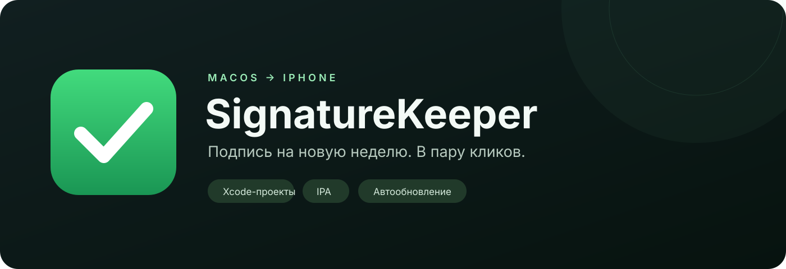
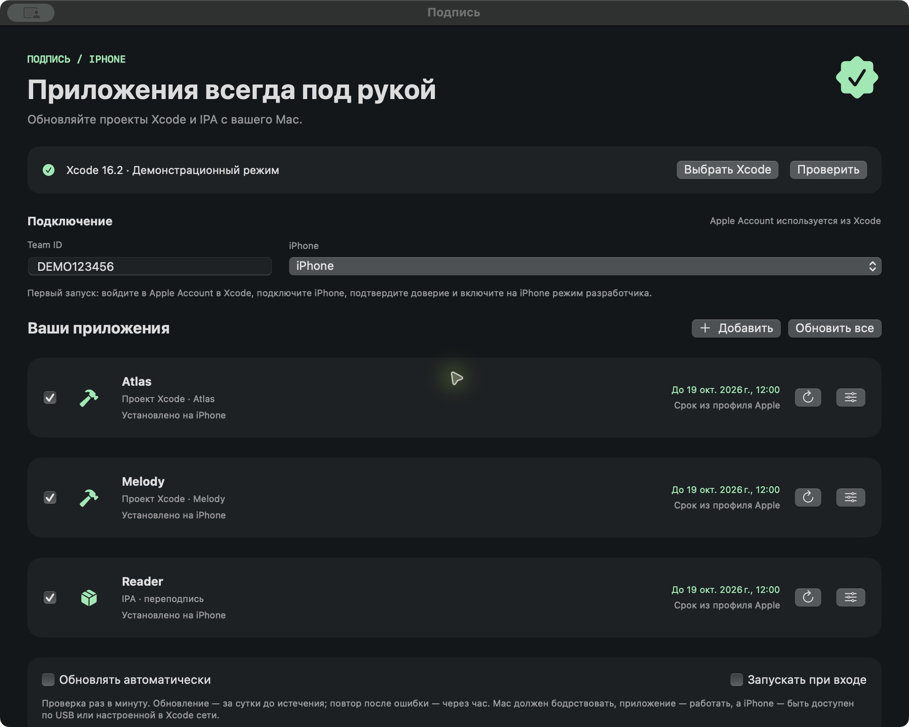
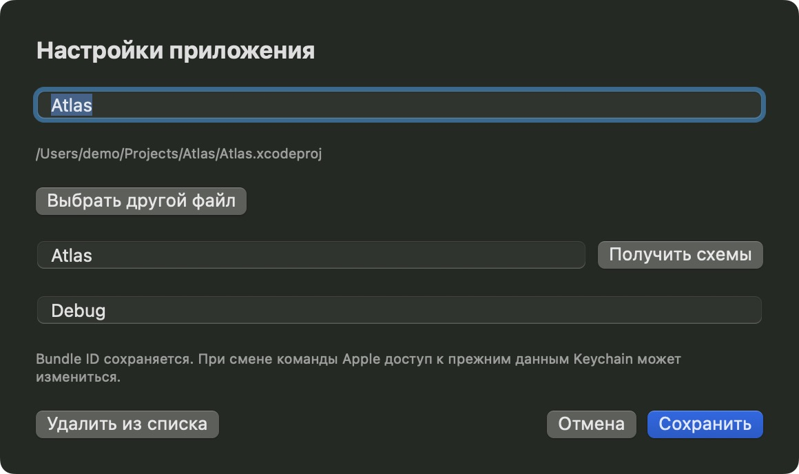
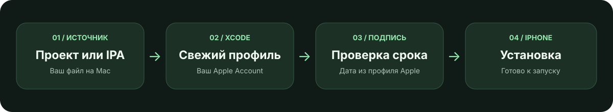

<div align="center">



# SignatureKeeper · Подпись

**Нативная утилита для Mac, которая обновляет подпись ваших iOS-приложений.**

Проекты Xcode и IPA · реальный срок из профиля Apple · ручное и автоматическое обновление


[**Скачать для Mac**](https://github.com/wilberods-coder/SignatureKeeper/releases/latest/download/SignatureKeeper-macOS.zip) · [Первый запуск](#первый-запуск) · [Как это работает](#как-это-работает) · [Сборка из исходников](#сборка-из-исходников)

</div>

---

## Приложения всегда под рукой

Бесплатный Personal Team позволяет устанавливать свои приложения на iPhone, но его профили действуют **7 дней**. SignatureKeeper собирает проекты, запрашивает профиль через Xcode, подписывает приложение и устанавливает его на выбранный iPhone.

Вместо расчётного таймера утилита показывает **настоящую дату окончания из профиля Apple**, после успешной установки.

<p align="center"></p>

<p align="center"><sub>Реальный интерфейс утилиты с демонстрационными приложениями и данными.</sub></p>

## Что умеет

| Возможность | Что происходит |
| --- | --- |
| **Проекты Xcode** | Сборка `.xcodeproj` или `.xcworkspace` с выбранной схемой и конфигурацией. |
| **IPA** | Переподпись копии незашифрованного IPA, библиотек и расширений. |
| **Свежий профиль** | Ручное обновление обнаруживает старый профиль Xcode и запрашивает новый. Проверяет, что срок увеличился. |
| **Автообновление** | Попытка обновить приложение за сутки до истечения; после ошибки — повтор не раньше чем через час. |
| **Строка меню** | Утилита продолжает работать после закрытия окна. Есть запуск при входе в macOS. |
| **Любые будущие приложения** | Источники добавляются и заменяются через выбор файлов. |
| **Небольшая нагрузка** | Приложения собираются последовательно, максимум две задачи компиляции одновременно. |
| **Понятный журнал** | Видны этапы сборки, подписи и установки, а также причины ошибок. |

## Первый запуск

### 1. Установите утилиту

Скачайте [SignatureKeeper-macOS.zip](https://github.com/wilberods-coder/SignatureKeeper/releases/latest/download/SignatureKeeper-macOS.zip), распакуйте архив и перенесите **«Подпись.app»** в **«Программы»**. Затем откройте её из Launchpad.

Архив содержит универсальную сборку для **Intel и Apple Silicon**. Сборка подписана локально, без Developer ID и нотариального заверения Apple; macOS может запросить подтверждение первого открытия.

### 2. Подготовьте Xcode и iPhone

- Нужен **полный Xcode 15 или новее** с `xcodebuild` и `devicectl`. Одних Command Line Tools недостаточно.
- Выберите Xcode, совместимый с вашей macOS и iOS: [таблица требований Apple](https://developer.apple.com/xcode/system-requirements).
- Войдите в свой Apple Account в **Xcode → Settings → Accounts**.
- Подключите iPhone по USB, разблокируйте его и подтвердите доверие к Mac.
- Включите **режим разработчика** на iPhone. Устройство должно быть доступно в Xcode и `devicectl`; ориентируйтесь на iOS 17+.
- Для исходного проекта сначала проверьте обычный запуск из Xcode с вашим Personal Team.

Интерфейс утилиты требует macOS 13+. Сам Xcode может требовать более новую macOS: например, Xcode 15 требует macOS 13.5 или новее.

### 3. Добавьте приложения

В «Подписи» выберите Xcode, нажмите **«Проверить»**, выберите iPhone и укажите **Team ID** из Signing & Capabilities вашего проекта.

Нажмите **«Добавить»** и выберите проект либо IPA. Для проекта проверьте схему и конфигурацию. Если проект использует CocoaPods, выбирайте `.xcworkspace`.

<p align="center"></p>

### 4. Обновите подпись

Нажмите кнопку ↻ у приложения. После успешной установки появится новый срок. Для нескольких приложений есть кнопка **«Обновить все»** — она обрабатывает записи с установленной галочкой.

После первого успешного ручного обновления можно включить **«Обновлять автоматически»** и **«Запускать при входе»**.

## Как это работает



**Проект:** `xcodebuild` собирает приложение с автоматическим управлением подписью. Утилита проверяет профиль, подпись и включение выбранного iPhone, затем устанавливает результат через `devicectl`.

**IPA:** утилита распаковывает копию на диск и проверяет шифрование. Временный минимальный проект с тем же Bundle ID запрашивает профиль и необходимые возможности через Xcode. После этого переподписываются библиотеки, расширения и основное приложение. Исходный IPA сохраняется, временные файлы удаляются.

**Старый профиль:** Xcode может использовать уже существующий профиль. При ручном обновлении SignatureKeeper временно убирает только профили, использованные этим приложением, из стандартных кешей и повторяет сборку. При неудаче возвращает их. Если новый профиль не увеличил срок, продление не объявляется успешным.

## Автоматическое обновление

Утилита проверяет список раз в минуту и начинает обновление за сутки до истечения подписи. Новый источник или смена выбранного iPhone тоже требуют установки. После неудачной попытки действует пауза в один час.

Для работы должны выполняться три условия:

1. **Mac включён и бодрствует.**
2. **«Подпись» запущена** — достаточно значка в строке меню.
3. **iPhone доступен** по USB либо по сети, предварительно настроенной в Xcode.

Выключенный или спящий Mac не обновляет подпись. Если автообновление выключено, используйте ручную кнопку.

## Ограничения

- Ограничения бесплатного Personal Team продолжают действовать. Утилита не увеличивает срок профиля сверх разрешённого Apple.
- IPA из App Store с шифрованием не поддерживаются. Нужен незашифрованный IPA от разработчика.
- Watch-компоненты и вложенные приложения сейчас не поддерживаются; обычные расширения `.appex` поддерживаются.
- Если аккаунт или профиль не разрешает запрошенные entitlements, операция останавливается. Возможности приложения не удаляются молча.
- Несколько расширений могут упереться в ограничения регистрации App ID бесплатного аккаунта.
- Bundle ID сохраняется, приложение перед установкой не удаляется. При смене Apple Team доступ к прежним данным Keychain может измениться.
- Проверка на реальном iPhone выполнена для проектов и IPA с Xcode 16.2. Поддержка остальных комбинаций Xcode, iOS и возможностей требует проверки.

## Данные, разрешения и место на диске

Пароль Apple Account утилита не запрашивает. Авторизация используется из Xcode, сертификаты и ключи — из Связки ключей. В утилите нет собственной аналитики или сервера; Xcode общается с Apple для управления подписью.

| Данные | Где находятся |
| --- | --- |
| Список приложений и настройки | `~/Library/Application Support/SignatureKeeper/settings.json` |
| Кэш сборок | `~/Library/Caches/SignatureKeeper` |
| Профили и сертификаты | Стандартные хранилища Xcode и Связка ключей |

macOS может запросить доступ к «Документам» или «Загрузкам», если в них находятся проекты, IPA или Xcode. После пересборки самой локально подписанной утилиты разрешения могут потребоваться снова.

Кэш переиспользуется. Его размер зависит от проектов: большая игра может занимать сотни мегабайт. Кнопка **«Очистить кэш сборок»** освобождает место; при следующей сборке кэш создаётся снова. Большие IPA обрабатываются на диске, проверка Mach-O читает заголовки, журнал ограничен 120 записями.

## Сборка из исходников

Нужны macOS и инструменты Swift из Xcode. Внешних пакетов нет.

```sh
git clone https://github.com/wilberods-coder/SignatureKeeper.git
cd SignatureKeeper
zsh scripts/check.sh
zsh scripts/build.sh
```

Результат: `dist/Подпись.app`. По умолчанию собирается архитектура текущего Mac.

Универсальная сборка и архив:

```sh
SIGNATURE_KEEPER_UNIVERSAL=1 zsh scripts/package.sh
```

Результат: `dist/SignatureKeeper-macOS.zip` и `dist/SHA256SUMS.txt`.

Если Xcode находится в нестандартной папке, для сборки можно указать `DEVELOPER_DIR`, а при запуске — выбрать Xcode в интерфейсе. Скрипт сборки использует локальный VFS-обход для некоторых установок Command Line Tools с дублирующимися объявлениями SwiftBridging и не изменяет системные файлы.

Проверки охватывают расписание, повторные попытки, регрессию повторного использования старого профиля, entitlements, шифрование Mach-O и передачу аргументов без shell. Интеграционная проверка установки требует доступного iPhone и аккаунта в Xcode.

## Вопросы и предложения

Нашли ошибку? [Создайте issue](https://github.com/wilberods-coder/SignatureKeeper/issues) с версией macOS/Xcode/iOS и нужным фрагментом журнала. Перед публикацией удалите личные пути, идентификаторы устройств и аккаунта.

## Документация Apple

- [Personal Team и семидневный срок профилей](https://developer.apple.com/help/account/basics/about-your-developer-account)
- [Обновление кешированных профилей Xcode](https://developer.apple.com/help/account/provisioning-profiles/edit-download-or-delete-profiles/)
- [Инструменты командной строки Xcode](https://developer.apple.com/documentation/xcode/xcode-command-line-tool-reference)
- [Контроль доступа к файлам в macOS](https://support.apple.com/en-gb/guide/security/secddd1d86a6/web)

---

<div align="center"><sub>Сделано на Swift и SwiftUI. Приложения подписываются вашим аккаунтом Apple.</sub></div>
